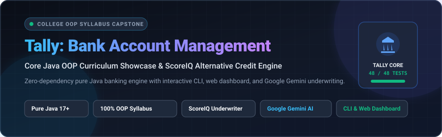
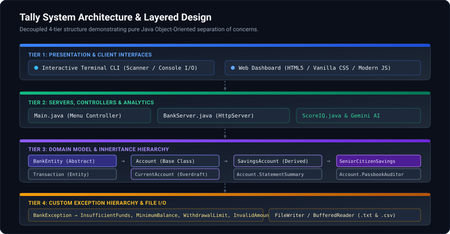
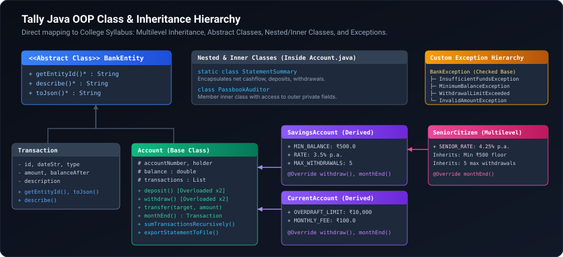
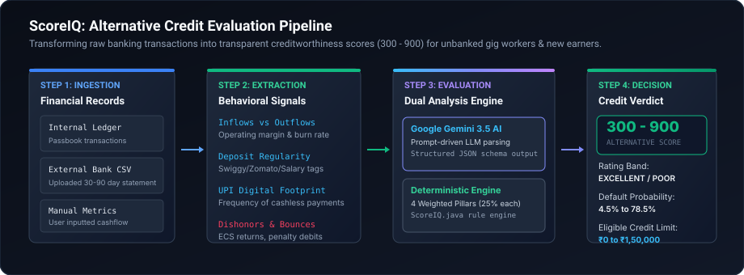
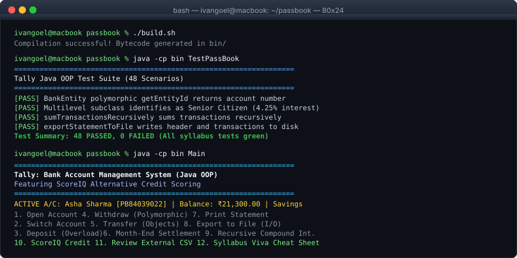

<div align="center">



<p align="center">
  
  
  
  
  
</p>

**An educational Object-Oriented Banking System and Alternative Underwriter built from scratch in pure, readable Java.**  
*Engineered specifically for university computer science laboratory evaluations, capstone submissions, and oral viva voce examinations.*

[Quick Start](#-quick-start--terminal-commands) •
[Architecture](#-system-architecture) •
[OOP Syllabus Map](#-complete-college-oop-syllabus-mapping) •
[ScoreIQ Engine](#-scoreiq-alternative-credit-scoring) •
[Viva Defense Guide](#-viva-voce-oral-defense-cheat-sheet)

</div>

---

## 🌟 Executive Summary & Dual Mission

Tally fulfills two critical purposes:

1. **Academic Excellence (100% Syllabus Coverage)**: Every single core topic in standard university Object-Oriented Programming syllabi is implemented in clean, idiomatic Java without external libraries. It features **Multilevel Inheritance, Abstract Classes, Polymorphism, Method Overloading, Objects as Parameters, Recursion, Member Inner Classes, Static Nested Classes, Custom Exception Hierarchies, and File I/O**.
2. **FinTech Innovation (ScoreIQ Alternative Credit Engine)**: Traditional credit rating bureaus (such as CIBIL and Experian) require an applicant to have prior debt history. Tally introduces **ScoreIQ**, an alternative cash-flow underwriter that assesses digital banking velocity, UPI habits, and liquidity to generate a transparent score (300 to 900) for unbanked gig-economy workers, freelancers, and students. It integrates both a deterministic rule engine and **Google Gemini 3.5 AI**.

---

## 🖥️ System Architecture

Tally follows a decoupled 4-tier modular architecture designed for maintainability and clear separation of concerns:

<div align="center">
  
</div>

### Layer Breakdown
- **Tier 1: Presentation Layer**: Dual interface consisting of a terminal-based CLI (`Main.java`) and a responsive web dashboard (`public/index.html`, `public/app.js`).
- **Tier 2: Service & Controller Layer**: Built-in HTTP server (`BankServer.java`) implementing zero-dependency REST endpoints, alongside `ScoreIQ.java` alternative underwriting logic.
- **Tier 3: Domain Entity Layer**: Encapsulated banking classes modeling accounts, transaction ledgers, balance assertions, and nested analytical helpers.
- **Tier 4: Exception & Storage Layer**: Checked domain exception hierarchy and persistence interfaces utilizing Java File I/O (`FileWriter`, `BufferedReader`).

---

## 🏛️ Class & Inheritance Hierarchy

<div align="center">
  
</div>

### Class Descriptions

| Class / Entity | Type | Role in OOP Hierarchy | Key Methods &amp; Syllabus Topics |
| :--- | :--- | :--- | :--- |
| **`BankEntity`** | `abstract class` | Contract Base | `getEntityId()`, `describe()`, `toJson()` (Enforces abstract method contracts) |
| **`Account`** | `class` | Base Domain Class | `deposit()` (Overloaded), `withdraw()`, `transfer()` (Objects as parameters), `monthEnd()`, recursion, and File I/O |
| **`SavingsAccount`** | `class` | Single Inheritance | Extends `Account`. Implements ₹500 floor, 3.5% p.a. interest, and 5-withdrawal monthly limit |
| **`SeniorCitizenSavingsAccount`** | `class` | **Multilevel Hierarchy** | Extends `SavingsAccount`. Overrides `monthEnd()` with preferential **4.25% p.a.** senior bonus interest |
| **`CurrentAccount`** | `class` | Hierarchical Subclass | Extends `Account`. Implements **₹10,000 overdraft facility** and ₹100 maintenance deduction |
| **`Transaction`** | `class` | Immutable Value Object | Extends `BankEntity`. Encapsulates immutable transaction records (`id`, `amount`, `balanceAfter`) |
| **`Account.StatementSummary`** | `static nested class` | Encapsulated Aggregator | Bundles net margin, debit/credit totals, and activity metrics |
| **`Account.PassbookAuditor`** | `inner class` | Member Inner Class | Retains direct access to outer instance `holder`, `balance`, and `transactions` fields |

---

## 📋 Complete College OOP Syllabus Mapping

The codebase maps 1-to-1 with university examination topics. Use this table during project presentations:

| Syllabus Unit | Key Academic Concepts | How Implemented in Tally | Source Code Location |
| :--- | :--- | :--- | :--- |
| **1. History &amp; Benefits of OOP** | Modularity, Encapsulation, Data Hiding, Code Reusability, Extensibility. | Bank balances are encapsulated (`protected` with controlled mutators). `BankEntity` guarantees contract extensibility. | [`src/BankEntity.java`](src/BankEntity.java), [`src/Account.java`](src/Account.java) |
| **2. Programming Fundamentals** | Control flow (`switch`, `if-else`), datatypes, wrapper classes (`Double.valueOf()`), type conversions, arrays (`Transaction[]`). | Menu routing in `Main.java`, transaction array returns in `transfer()`, numeric parsing in `BankServer.java`. | [`src/Main.java`](src/Main.java), [`src/BankServer.java`](src/BankServer.java) |
| **3. Introduction to Classes &amp; Objects** | Object reference variables, constructors, constructor overloading, method overloading. | 3 overloaded constructors in `Account`. Overloaded `deposit(double)` and `deposit(double, String)`. | [`src/Account.java`](src/Account.java#L30-L55) |
| **4. Objects as Parameters &amp; Return** | Passing object references by value; returning objects and arrays. | `transfer(Account target, double amount)` mutates sender and receiver; returns `Transaction[]`. | [`src/Account.java`](src/Account.java#L115-L135) |
| **5. Recursion in Methods** | Base conditions, recursive calls, call stack management. | `sumTransactionsRecursively()` and `calculateCompoundInterestRecursively()`. | [`src/Account.java`](src/Account.java#L160-L185) |
| **6. Nested &amp; Inner Classes** | Static nested classes vs. Non-static member inner classes. | `Account.StatementSummary` (static) and `Account.PassbookAuditor` (inner class accessing outer private fields). | [`src/Account.java`](src/Account.java#L230-L280) |
| **7. Console &amp; File I/O** | `Scanner`, `System.out.printf`, `FileWriter`, `PrintWriter`, `BufferedReader`. | Formatted console menu in `Main.java`. Disk export and file readback in `exportStatementToFile()` / `readStatementFile()`. | [`src/Main.java`](src/Main.java), [`src/Account.java`](src/Account.java#L190-L225) |
| **8. Inheritance &amp; Multilevel Hierarchy** | Base vs derived classes, `super` keyword, method overriding (`@Override`), multilevel hierarchy. | `BankEntity` → `Account` → `SavingsAccount` → `SeniorCitizenSavingsAccount`. Also `Account` → `CurrentAccount`. | [`src/SeniorCitizenSavingsAccount.java`](src/SeniorCitizenSavingsAccount.java) |
| **9. Abstract Classes** | Abstract methods, contract enforcement, inability to instantiate directly. | `BankEntity` declares abstract methods `getEntityId()`, `describe()`, and `toJson()`. | [`src/BankEntity.java`](src/BankEntity.java) |
| **10. Custom Exception Hierarchy** | Checked exceptions, `throw`, `throws`, `try-catch-finally`, domain error handling. | `BankException` base class with 4 domain subclasses: `InsufficientFunds`, `MinimumBalance`, `WithdrawalLimit`, `InvalidAmount`. | [`src/BankException.java`](src/BankException.java) |

---

## 🧠 ScoreIQ: Alternative Credit Scoring

<div align="center">
  
</div>

### The Problem It Solves
Over 60% of India's working population (gig workers, delivery executives, small merchants, fresh college graduates) are deemed **"Credit Invisible"** by traditional credit bureaus because they have never taken a bank loan.

### How ScoreIQ Evaluates Creditworthiness
ScoreIQ bypasses prior loan debt and evaluates actual **cash-flow discipline** across 4 weighted pillars:

```
ScoreIQ = 300 + ( (Activity × 0.20) + (Regularity × 0.25) + (Savings × 0.25) + (Stability × 0.30) ) × 6.0
```

1. **Transaction Velocity (20%)**: Healthy cadence of day-to-day digital transactions and UPI payments.
2. **Deposit Regularity (25%)**: Predictable frequency of incoming earnings (e.g. Swiggy weekly payouts, merchant QR collections, salary).
3. **Savings Buffer (25%)**: Retained monthly liquidity margin (`Inflows - Outflows`).
4. **Institutional Stability (30%)**: Maintaining positive balances; zero cheque bounces or ECS/NACH return dishonors.

### Dual Engine: Google Gemini 3.5 AI &amp; Local Deterministic Fallback
- **Google Gemini 3.5 Flash Integration**: Accepts raw external bank CSV files, extracts behavioral nuances (e.g. gambling debits vs. business stock purchases), and generates structured JSON with risk flags, probability of default (PD), and recommended credit limits.
- **Deterministic Rule Engine**: An offline, mathematical fallback that executes the 4-pillar formula locally with zero API dependency.

---

## 💻 Terminal CLI Preview

<div align="center">
  
</div>

---

## 🚀 Quick Start &amp; Terminal Commands

### Prerequisites
- Java Development Kit (**JDK 17 or higher**)
- Operating System: macOS, Linux, or Windows (via PowerShell / Git Bash)

### 1. Clone &amp; Navigate to the Project Root
```bash
git clone https://github.com/IVAN-GOEL/Tally-Bank-account-management-system.git
cd Tally-Bank-account-management-system
```

> **Important**: Always execute commands from the project root folder. Do **not** `cd` into `src/`, otherwise `src/*.java` will not resolve.

### 2. Compile All Java Sources
```bash
./build.sh
```
*(Or manually: `mkdir -p bin && javac -d bin src/*.java`)*

### 3. Run the Comprehensive Test Suite (48/48 Scenarios)
```bash
./test.sh
```
*(Or manually: `java -cp bin TestPassBook`)*

### 4. Launch the Interactive Terminal CLI
```bash
./run-cli.sh
```
*(Or manually: `java -cp bin Main`)*

### 5. Launch the Web Server &amp; GUI Dashboard
```bash
./run-server.sh 8080
```
Open your web browser and visit:  
**`http://localhost:8080`**

---

## 🎓 Viva Voce Oral Defense Cheat Sheet

Use these quick answers when defending the project before your professor or lab examiner:

### Q1: Why use an Abstract Class (`BankEntity`) instead of an Interface?
> **Answer**: `BankEntity` defines a shared conceptual identity for all banking entities and allows for future non-abstract default state, whereas an interface represents a pure behavioral capability. Subclasses like `Account` and `Transaction` are fundamentally `BankEntities` (*is-a* relationship).

### Q2: What is the difference between Method Overloading and Method Overriding in this project?
> **Answer**:
> - **Overloading (Compile-Time Polymorphism)**: Occurs within `Account.java`, where `deposit(double amount)` and `deposit(double amount, String description)` share the same name but different parameter lists.
> - **Overriding (Run-Time Polymorphism)**: Occurs in subclasses like `SavingsAccount` and `CurrentAccount`, which override `withdraw()` and `monthEnd()` with `@Override` annotations to implement custom rules (such as minimum balance checks or overdraft charges).

### Q3: How is Multilevel Inheritance demonstrated?
> **Answer**: Through the hierarchy:  
> `BankEntity` *(Abstract Base)* → `Account` *(Base Class)* → `SavingsAccount` *(Derived Class)* → `SeniorCitizenSavingsAccount` *(Multilevel Derived Subclass)*.  
> `SeniorCitizenSavingsAccount` inherits the ₹500 floor and 5-withdrawal cap from `SavingsAccount`, but overrides `monthEnd()` to credit a preferential **4.25% p.a.** interest rate.

### Q4: Why are custom exceptions in Tally Checked Exceptions?
> **Answer**: `BankException` extends `java.lang.Exception` (not `RuntimeException`). In a banking ledger, balance shortages or overdraft breaches are recoverable business domain conditions that the caller must explicitly handle using `try-catch` blocks.

### Q5: Where and why is Recursion used instead of loops?
> **Answer**: In `Account.sumTransactionsRecursively()` and `Account.calculateCompoundInterestRecursively()`. They demonstrate recursive problem decomposition:
> - Base Case: When the transaction list index reaches the end, or remaining years equal zero.
> - Recursive Step: Accumulate the current element and call the function with the decremented subproblem (`index + 1` or `yearsRemaining - 1`).

### Q6: What is the practical difference between the Static Nested Class and Member Inner Class in `Account.java`?
> **Answer**:
> - `Account.StatementSummary` is **static**: It does not hold an implicit reference to an enclosing `Account` instance; it is an independent data holder for metrics.
> - `Account.PassbookAuditor` is a **member inner class**: It has direct, implicit access to the enclosing `Account`'s private fields (`holder`, `balance`, `transactions`) to perform live integrity audits.

---

## 📂 Project Structure

```
Tally-Bank-account-management-system/
├── src/                                  # Pure Java source files (Syllabus implementation)
│   ├── BankEntity.java                   # Abstract base class
│   ├── Account.java                      # Base account class (overloading, recursion, nested classes)
│   ├── SavingsAccount.java               # Derived class (3.5% interest, min balance floor)
│   ├── SeniorCitizenSavingsAccount.java  # Multilevel derived class (4.25% preferential rate)
│   ├── CurrentAccount.java               # Derived class (₹10,000 overdraft limit)
│   ├── Transaction.java                  # Immutable ledger entry
│   ├── ScoreIQ.java                      # Alternative credit scoring engine
│   ├── BankException.java                # Checked exception base class
│   ├── InsufficientFundsException.java   # Domain exception
│   ├── MinimumBalanceException.java      # Domain exception
│   ├── WithdrawalLimitExceededException.java # Domain exception
│   ├── InvalidAmountException.java       # Domain exception
│   ├── Main.java                         # Interactive terminal CLI controller
│   ├── BankServer.java                   # Zero-dependency embedded HTTP server
│   └── TestPassBook.java                 # 48-scenario unit test suite
├── public/                               # Modern web application assets
│   ├── index.html                        # Dashboard markup
│   ├── app.js                            # Frontend controller & Gemini AI handler
│   └── styles.css                        # Design system & dark theme styling
├── docs/assets/                          # Visual SVGs and architectural diagrams
│   ├── banner.svg                        # Project hero banner
│   ├── architecture.svg                  # 4-tier system architecture
│   ├── class-hierarchy.svg               # UML class diagram
│   ├── scoreiq-pipeline.svg              # Underwriting workflow
│   └── terminal-preview.svg              # Terminal CLI mockup
├── build.sh                              # Source compilation script
├── test.sh                               # Test execution script
├── run-cli.sh                            # Terminal CLI launcher
├── run-server.sh                         # Web server launcher
└── README.md                             # Comprehensive documentation & syllabus guide
```

---

## 📄 License & Academic Integrity

This project is released under the **MIT License**. It is designed as an open-source educational reference for computer science students and educators. When submitting for university coursework, ensure appropriate attribution in accordance with your institution's academic integrity policies.
