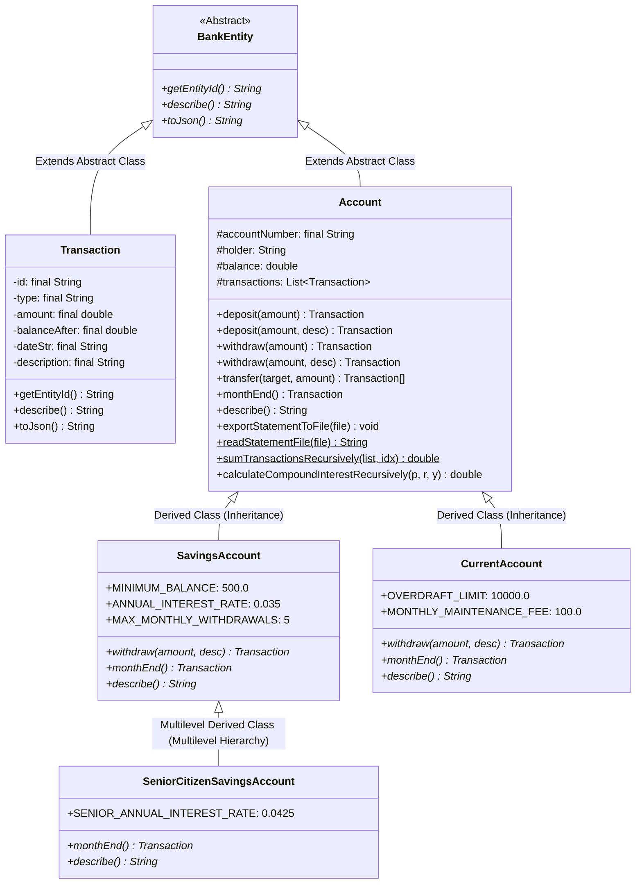

# PassBook: Bank Account Management System & ScoreIQ (Java OOP)

> *"A small bank, built from classes — aligned directly with the College OOP Syllabus."*

PassBook is an educational **Object-Oriented Programming (OOP) mini-project** built in **pure, beginner-readable Java** for college computer science coursework, laboratory evaluations, and viva voce examinations. It models a commercial bank passbook ledger while demonstrating all core curriculum topics: **Class Fundamentals, Object Reference Variables, Method & Constructor Overloading, Objects as Parameters, Recursion, Static Nested & Inner Classes, Console & File I/O, Multilevel Inheritance, Abstract Classes, Method Overriding, Custom Exception Hierarchies, and ScoreIQ Alternative Credit Scoring**.

---

## 1. Complete College Course Syllabus Mapping

This codebase is specifically engineered to demonstrate the key units of the Object-Oriented Programming (OOP) syllabus:



| Syllabus Topic | Concepts Covered | Implementation in PassBook | Source File |
| :--- | :--- | :--- | :--- |
| **1. History & Evolution of OOP** | Benefits of OOP (Modularity, Data Hiding, Reusability, Extensibility); Applications in enterprise systems; Java vs C++ vs C# architecture (JVM Bytecode, Garbage Collection, pointer safety, single class inheritance). | Explains benefits via encapsulated bank balances and transaction logging; abstract class `BankEntity` enforces core contracts. | [`src/BankEntity.java`](src/BankEntity.java) |
| **2. Programming Fundamentals** | Control flow statements (`if-else`, `switch-case`, `while`, `for-each`); Operators; Datatypes (primitive `double`, `int`, `boolean` vs reference types); Type conversion & explicit narrowing casts `(int) Math.round()`; Wrapper classes (`Double.valueOf()`, `Integer.parseInt()`); Arrays (`Transaction[]`). | Menu control in `Main.java`, transaction routing in `BankServer.java`, array returns in `transfer()`. | [`src/Main.java`](src/Main.java), [`src/Account.java`](src/Account.java) |
| **3. Introduction to Classes** | Class fundamentals; Declaring objects; Assigning object reference variables; Methods; Constructors; Constructor Overloading (3 constructors in Account); Method Overloading (`deposit` & `withdraw` variants); Objects as parameters (`transfer(Account target, double amount)`); Argument passing (pass-by-value of reference); Returning objects (`Transaction`, `Transaction[]`, `StatementSummary`); Recursion; Access control (`private`, `protected`, `public`); `final` keyword; Static Nested Classes (`StatementSummary`) & Member Inner Classes (`PassbookAuditor`). | Encapsulated balance mutation; recursive compounding; nested summary classes. | [`src/Account.java`](src/Account.java), [`src/Transaction.java`](src/Transaction.java) |
| **4. I/O Basics** | Reading Console Input (`Scanner`); Writing Console Output (`System.out.printf`); File Handling (`FileWriter`, `PrintWriter`, `FileReader`, `BufferedReader`). | Console interface in `Main.java`; File export and readback methods `exportStatementToFile()` and `readStatementFile()`. | [`src/Main.java`](src/Main.java), [`src/Account.java`](src/Account.java) |
| **5. Inheritance** | Base and derived classes; Multilevel hierarchy (`BankEntity` -> `Account` -> `SavingsAccount` -> `SeniorCitizenSavingsAccount`); Access modifiers in inheritance (`protected` fields); Method overriding (`@Override` on `withdraw()`, `monthEnd()`, `describe()`); Abstract classes (`BankEntity`). | Subclass-specific banking rules; senior citizen preferential 4.25% interest rate. | [`src/Account.java`](src/Account.java), [`src/SavingsAccount.java`](src/SavingsAccount.java), [`src/SeniorCitizenSavingsAccount.java`](src/SeniorCitizenSavingsAccount.java), [`src/CurrentAccount.java`](src/CurrentAccount.java) |
| **6. Exception Handling** | Exception types (Checked vs Unchecked); Creating custom exceptions; Exception hierarchy (`BankException extends Exception`); `try`, `catch`, `finally`, `throw`, `throws`. | Domain errors: `InsufficientFundsException`, `MinimumBalanceException`, `WithdrawalLimitExceededException`, `InvalidAmountException`. | [`src/BankException.java`](src/BankException.java) & exception classes |
| **7. Side Feature: ScoreIQ** | Deterministic, transparent alternative credit score (300 to 900) based on passbook cash flow discipline without requiring loan debt history. | Evaluates Transaction Activity, Regularity, Savings Habit, Stability, and UPI velocity. | [`src/ScoreIQ.java`](src/ScoreIQ.java) |

---

## 2. In-Depth Syllabus Demonstrations

### A. Recursion (Syllabus: "Recursion in Methods")
Located in [`src/Account.java`](src/Account.java):
1. **Recursive Transaction Summation**:
   ```java
   public static double sumTransactionsRecursively(List<Transaction> list, int index) {
       if (list == null || index >= list.size()) return 0.0; // Base case
       return list.get(index).getAmount() + sumTransactionsRecursively(list, index + 1); // Recursive case
   }
   ```
2. **Recursive Compound Interest Projection**:
   ```java
   public double calculateCompoundInterestRecursively(double principal, double annualRate, int yearsRemaining) {
       if (yearsRemaining <= 0) return Math.round(principal * 100.0) / 100.0; // Base case
       double accumulated = principal * (1.0 + annualRate);
       return calculateCompoundInterestRecursively(accumulated, annualRate, yearsRemaining - 1); // Recursive case
   }
   ```

### B. Nested & Inner Classes (Syllabus: "Nested and Inner Classes")
Located in [`src/Account.java`](src/Account.java):
1. **Static Nested Class** (`Account.StatementSummary`):
   Encapsulates metrics (total deposits, total withdrawals, net cashflow, transaction count).
2. **Member Inner Class** (`Account.PassbookAuditor`):
   Has direct access to the outer instance's `holder`, `balance`, and `transactions` fields to perform internal consistency checks.

### C. File I/O (Syllabus: "Files Handling")
Located in [`src/Account.java`](src/Account.java):
1. **Writing to File**: `exportStatementToFile(String filePath)` writes an official ledger statement to disk using `java.io.FileWriter` and `java.io.PrintWriter`.
2. **Reading from File**: `readStatementFile(String filePath)` reads back the statement file line-by-line using `java.io.FileReader` and `java.io.BufferedReader`.

### D. Multilevel Hierarchy (Syllabus: "Multilevel Hierarchy")
Located in [`src/SeniorCitizenSavingsAccount.java`](src/SeniorCitizenSavingsAccount.java):
```
BankEntity (Abstract) -> Account (Base Class) -> SavingsAccount (Derived Class) -> SeniorCitizenSavingsAccount (Multilevel Subclass)
```
- `SeniorCitizenSavingsAccount` inherits withdrawal rules and minimum balance from `SavingsAccount`.
- Overrides `monthEnd()` to credit a preferential **4.25% per annum** monthly interest (+0.75% senior citizen bonus).

### E. Custom Exception Hierarchy (Syllabus: "Creating Exception")
```
java.lang.Exception (Checked base)
└── BankException (Custom domain base)
    ├── InsufficientFundsException (Balance or overdraft floor breach)
    ├── MinimumBalanceException (Savings account drops below ₹500 floor)
    ├── WithdrawalLimitExceededException (Exceeded 5 withdrawals/month)
    └── InvalidAmountException (Attempting transaction <= ₹0)
```

---

## 3. How to Run & Test (Exact Terminal Commands)

### 1. Compile All Java Sources
```bash
javac -d bin src/*.java
```

### 2. Run the Comprehensive Java Test Suite (48 Verification Scenarios)
Verifies all OOP behaviors, exceptions, recursion, multilevel hierarchy, and file I/O:
```bash
java -cp bin TestPassBook
```
Expected output:
```
==================================================================
       PassBook Java OOP Test Suite (23 Verification Scenarios)    
==================================================================
 [PASS] ... (all scenarios)
--- Testing Syllabus Concepts (Inheritance, Abstraction, Recursion, I/O) ---
 [PASS] BankEntity polymorphic getEntityId returns account number
 [PASS] Multilevel subclass identifies as Senior Citizen
 [PASS] sumTransactionsRecursively sums transactions recursively
 [PASS] calculateCompoundInterestRecursively projects compound growth over 2 years (₹1,210.00)
 [PASS] exportStatementToFile writes header
==================================================================
Test Summary: 48 PASSED, 0 FAILED
==================================================================
```

### 3. Run the Interactive Console Menu (For Lab & Viva Demonstrations)
```bash
java -cp bin Main
```

### 4. Launch the Web Server (Full Browser UI with Sidebar)
```bash
java -cp bin BankServer 8080
```
Open your browser and navigate to:
```
http://localhost:8080
```

### 5. Optional Python Test Suite (For Vercel Serverless Verification)
```bash
python3 -m unittest discover tests
```
Runs 23 unit tests verifying the Python models.

---

## 4. ScoreIQ Credit Scoring Details

ScoreIQ addresses **Credit Invisibility** in India for gig workers, fresh graduates, and self-employed professionals who lack CIBIL loan debt histories:
- **Transparent & Deterministic**: Rule-based weighted calculation. No black-box machine learning.
- **Score Scale**: 300 to 900 (mirroring standard Indian bureaus).
- **Core Factors Evaluated**:
  1. Transaction Activity (25% weight): Volume and frequency of healthy transactions.
  2. Deposit Regularity (25% weight): Consistency of recurring incoming deposits.
  3. Savings Habit (25% weight): Percentage of funds retained as liquid reserves.
  4. Account Stability (25% weight): Maintaining positive balances and zero overdraft distress.
